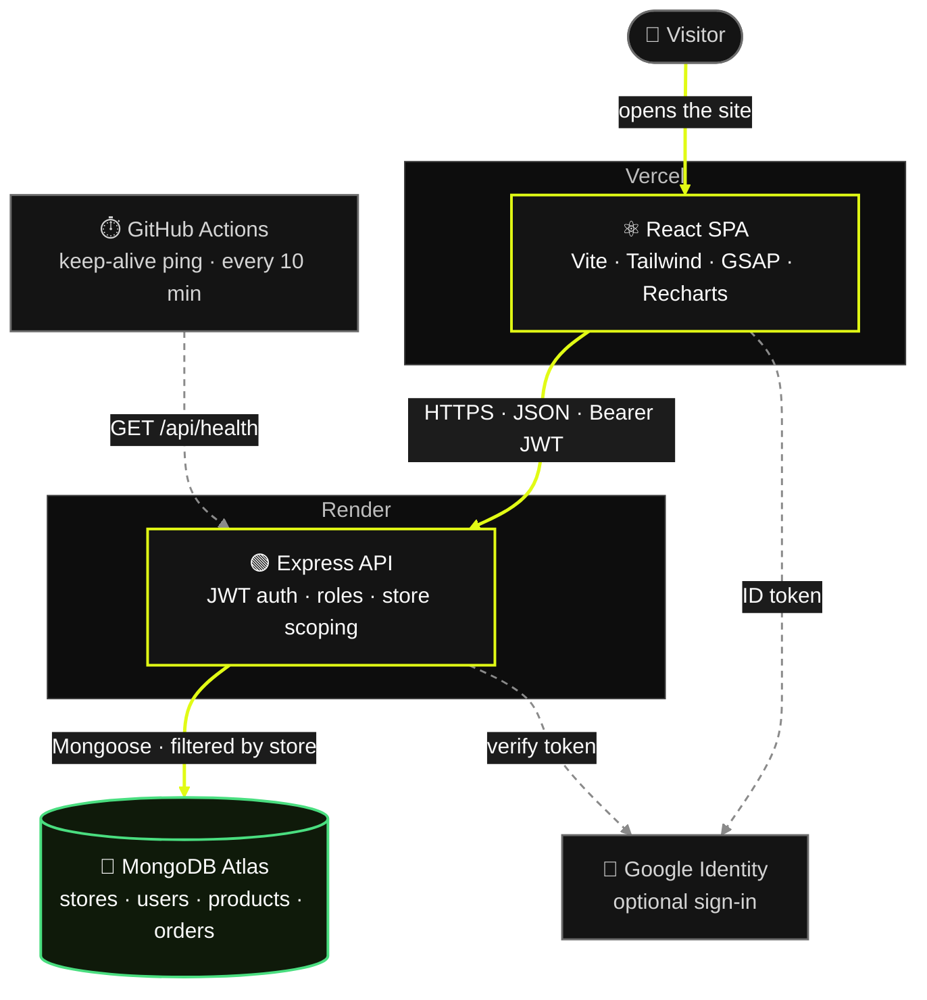

<div align="center">


# Vendora

**A multi-tenant SaaS dashboard for running an online store: sales analytics, inventory, orders and team access in one place.**

[](https://vendora-saa-s-e-commerce-dashboard.vercel.app/)


</div>

---

## 🧭 Overview

Vendora is a full-stack MERN application where any business can sign up, get its own private store, and invite its team. Each store's products, orders, notifications and users are isolated from every other store at the API level.

The interface is a dark, responsive dashboard built for both desktop and phones. Owners get revenue and profit analytics, a low-stock early warning, order processing with server-side stock checks, and branded PDF reports for any date range.

### How it works

1. **Create a store** from the sign-in page (or sign in with Google). You become its Admin.
2. **Add products** in Inventory with a selling price, cost price and stock level.
3. **Record orders.** Stock is reserved automatically, and you are warned when items run low.
4. **Add your team** from the Team page as Admin or Staff.
5. **Track performance** on the dashboard and export a PDF report for any period.

---

## 🚀 Try the live demo

Open the **[live demo](https://vendora-saa-s-e-commerce-dashboard.vercel.app/)** and choose **Explore as Admin** or **Explore as Staff** on the sign-in page. No account or password is needed.

The demo signs you in to a shared sample store, so changes are visible to other visitors. Its accounts can't be changed or taken over, and its team and name are locked. To try team management, choose **Create store** and sign up with your own store.

> The API runs on a free hosting tier and may take a few seconds to wake up on the first request.

---

## ✨ Features

### Stores, accounts and teams
- **Self-service sign-up.** Creating an account creates a new, empty store and makes you its Admin (owner).
- **Tenant isolation.** Every user, product, order and notification belongs to one store. Every query is filtered by the signed-in user's store, so one business can never read or change another's data.
- **Team management.** Admins add teammates as Admin or Staff with a starting password, change roles, remove members and rename the store. The owner cannot be removed or demoted, and nobody can change their own role.
- **Sessions that follow permissions.** Changing a member's role or removing them signs them out immediately (token versioning). Changing your own email or password does the same for old sessions.
- **Optional Google sign-in.** A first-time Google user gets their own store.
- **Profiles.** Name, phone, address, avatar upload and removal, and email or password changes.

### Analytics dashboard
- Revenue, orders, net profit, gross margin and average order value for any range: today, last 7 days, last 30 days, this month, or custom dates.
- Growth compared with the previous period of the same length.
- Sales trend, order status mix, best sellers, profitability, fulfilment health and the latest orders, built with Recharts.
- Auto-refresh every 30 seconds. All amounts are shown in Sri Lankan Rupees (Rs.).

### Reports
- **Export report** opens a preview for any range. It starts with the range selected on the dashboard, and you can switch to any other range in the dialog.
- Downloads a branded A4 PDF: a header band with the Vendora logo and store name, summary tiles, key metrics, orders by status, top products and daily order value.
- Every page has a footer with page numbers. Short tables never split across pages, and long tables repeat their header row.

### Inventory
- Full product management for Admins, including name, description, price, cost price, stock, category and image URL.
- Summary of total products, low and out-of-stock counts and stock value.
- Search, category filter, stock filter (all, low, out of stock), sorting and pagination.
- Margin shown for every product, with a warning when any product is priced below cost. Cost price also feeds the dashboard's profit figures.

### Orders
- Create orders with several products. Stock is checked and reserved on the server, and totals are recalculated there, so the client can't send a wrong amount.
- Status workflow: Pending, Processing, Shipped, Delivered. Status changes update the screen instantly and roll back automatically if the request fails.
- Search, status filter, sorting and pagination.

### Alerts and notifications
- **Low-stock banner** for products under 10 units, with a list of the affected items and a Restock shortcut.
- The banner can be dismissed for two hours in that browser. It comes back sooner if the set of low-stock products or their quantities change.
- Notification bell with an unread count for new orders and status changes, with mark-as-read and mark-all-read. Notifications go only to the store's own team.
- Header search jumps straight to matching orders.

### Experience
- Responsive from 360 px phones to wide desktops. Pages never scroll sideways on phones, and form fields are sized so iOS doesn't zoom in on focus.
- The sign-in page fits on one screen without scrolling. The browser Back button returns from the dashboard to the sign-in page instead of leaving the site.
- Subtle GSAP motion that turns off when the operating system's "reduce motion" setting is on.

---

## 🔐 Roles and permissions

| Capability                                   | Admin | Staff |
|----------------------------------------------|:-----:|:-----:|
| View dashboard analytics and export reports  |   ✓   |   ✓   |
| View and create orders, update order status  |   ✓   |   ✓   |
| Edit or delete orders (API only)              |   ✓   |       |
| View low-stock alerts                         |   ✓   |   ✓   |
| Add, edit and delete products (Inventory)     |   ✓   |       |
| Manage team members and rename the store      |   ✓   |       |
| Edit own profile, email and password          |   ✓   |   ✓   |

Permissions are enforced on the API, not just hidden in the interface.

---

## 🛠️ Tech stack

| Layer     | Technology |
|-----------|------------|
| Frontend  | React 18, Vite 5, React Router 6, Tailwind CSS 4 |
| Charts    | Recharts |
| Motion    | GSAP (`@gsap/react`) |
| Reports   | jsPDF, jspdf-autotable |
| HTTP      | Axios |
| Icons     | Lucide React |
| Backend   | Node.js, Express 4 |
| Database  | MongoDB, Mongoose 8 |
| Auth      | JSON Web Tokens, bcrypt.js, Google Identity Services (optional) |
| Uploads   | Multer |
| Local dev | `mongodb-memory-server` (zero-setup database), `concurrently`, nodemon |

---

## 🏗️ Architecture



Solid lime lines are the main request path; dashed lines are optional or background traffic.

**How tenant isolation works.** The `protect` middleware verifies the JWT, loads the user, checks the token version, and sets `req.storeId` from the user record in the database. It never takes the store from the request. Every controller filters by `req.storeId`, and create and update handlers only accept a whitelist of fields, so a client can't move a record into another store.

---

## 📁 Project structure

```text
Vendora/
├── backend/
│   ├── uploads/                    # Uploaded avatars (created at runtime, not in Git)
│   └── src/
│       ├── app.js                  # Express app and route mounting
│       ├── server.js               # Starts the API, then connects to MongoDB (with retries) and runs the tenancy migration
│       ├── controllers/            # auth, store (team), product, order, notification
│       ├── middleware/             # protect (JWT + store scope), authorize (roles)
│       ├── models/                 # Store, User, Product, Order, Notification
│       ├── routes/                 # /api/auth, /store, /products, /orders, /notifications
│       ├── utils/                  # accounts, ensureTenancy, notifyStaffAdmins, generateToken
│       ├── seed/seedData.js        # Resets the shared demo store
│       └── dev/localServer.js      # In-memory MongoDB + seed + 30 days of sample orders
├── frontend/
│   ├── public/                     # Logo and favicons
│   └── src/
│       ├── pages/                  # auth, dashboard, orders, inventory, team, profile
│       ├── components/             # layout, alerts, ui (Modal, Select), reactbits (motion helpers)
│       ├── context/                # AuthContext, ToastContext
│       ├── routes/                 # ProtectedRoute (sign-in and role guard)
│       ├── hooks/, lib/            # Shared hooks and GSAP setup
│       ├── services/api.js         # Axios instance and auth interceptors
│       └── utils/                  # reportPdf (PDF reports), formatCurrency, orderStatus
└── package.json                    # Root scripts that run backend and frontend together
```

---

## ⚡ Getting started

### Prerequisites
- Node.js 18 or newer
- MongoDB (local or Atlas). Not needed for the quick start below.

### 1. Install dependencies

```bash
npm install
npm install --prefix backend
npm install --prefix frontend
```

### 2a. Quick start (no MongoDB needed)

```bash
npm run dev:local
```

This starts a temporary in-memory MongoDB, seeds the demo store with about 30 days of sample orders, and runs:

- API: `http://localhost:5000` (health check at `/api/health`)
- App: `http://localhost:5173`

Data resets every time you restart. The first run downloads a MongoDB binary once (about 100 MB).

### 2b. Full setup with your own database

1. Copy `backend/.env.example` to `backend/.env` and `frontend/.env.example` to `frontend/.env`, then fill in the values (see the **Environment variables** section below).
2. Seed the demo store (optional, but needed for the demo buttons):

   ```bash
   npm run seed --prefix backend
   ```

3. Start both apps:

   ```bash
   npm run dev
   ```

### Production build

```bash
npm run build --prefix frontend
npm run start --prefix backend
```

---

## ⚙️ Environment variables

**Backend** (`backend/.env`)

| Variable             | Required | Description |
|----------------------|:--------:|-------------|
| `PORT`               |          | API port. Default `5000`. |
| `MONGO_URI`          |    ✓     | MongoDB connection string. |
| `JWT_SECRET`         |    ✓     | Long random secret used to sign tokens. |
| `JWT_EXPIRES_IN`     |          | Token lifetime. Default `7d`. |
| `DEMO_LOGIN_ENABLED` |          | `true` (default) shows the one-click demo buttons. Set to `false` to turn the demo off. |
| `DEMO_ADMIN_EMAIL`   |          | Demo Admin account. Default `admin@vendora.com`. |
| `DEMO_STAFF_EMAIL`   |          | Demo Staff account. Default `staff@vendora.com`. |
| `DEMO_ADMIN_PASSWORD`|          | Password `npm run seed` gives the demo Admin. Set it in production. |
| `DEMO_STAFF_PASSWORD`|          | Password `npm run seed` gives the demo Staff. Set it in production. |
| `GOOGLE_CLIENT_ID`   |          | OAuth client ID for Google sign-in. Leave empty to turn it off. |

**Frontend** (`frontend/.env`)

| Variable                | Required | Description |
|-------------------------|:--------:|-------------|
| `VITE_API_BASE_URL`     |    ✓     | API base URL, for example `http://localhost:5000/api`. |
| `VITE_GOOGLE_CLIENT_ID` |          | Same client ID as the backend. Leave empty to hide the Google button. |

**Google sign-in (optional).** Create an OAuth 2.0 *Web application* client in Google Cloud Console. Add your frontend URLs (for example `http://localhost:5173` and your production domain) under *Authorized JavaScript origins*, then use the same client ID in both files.

Never commit `.env` files. Only the `.env.example` files belong in the repository.

---

## 📜 Available scripts

| Where      | Command               | What it does |
|------------|-----------------------|--------------|
| Root       | `npm run dev`         | Runs the API (nodemon) and the frontend together. |
| Root       | `npm run dev:local`   | Same, but with an in-memory MongoDB and seeded sample data. |
| Root       | `npm run dev:backend` | Runs the API only. |
| Root       | `npm run dev:frontend`| Runs the frontend only. |
| `backend`  | `npm run start`       | Starts the API in production mode. |
| `backend`  | `npm run seed`        | Resets the shared demo store (uses `DEMO_*` settings). Other stores are not touched. |
| `frontend` | `npm run build`       | Builds the production bundle into `frontend/dist`. |
| `frontend` | `npm run preview`     | Serves the production build locally. |

---

## 📡 API reference

Base URL: `/api`. Protected routes need an `Authorization: Bearer <token>` header. Every protected route works only inside the caller's own store.

<details>
<summary><strong>Auth</strong> (<code>/api/auth</code>)</summary>

| Method   | Path        | Access    | Description |
|----------|-------------|-----------|-------------|
| `POST`   | `/signup`   | Public    | `{ name, email, password, storeName }`. Creates a store and signs in as its Admin. |
| `POST`   | `/login`    | Public    | `{ email, password }` |
| `POST`   | `/demo`     | Public    | `{ role: "Admin" \| "Staff" }`. Signs in to the shared demo store. |
| `POST`   | `/google`   | Public    | `{ credential }`. A first sign-in creates a store. |
| `GET`    | `/config`   | Public    | Tells the sign-in page which options are turned on. |
| `GET`    | `/me`       | Protected | Current user and store. |
| `PATCH`  | `/profile`  | Protected | Name, phone, address, avatar URL. |
| `PUT`    | `/password` | Protected | `{ currentPassword, newPassword }`. Signs out other sessions. |
| `PUT`    | `/email`    | Protected | `{ newEmail, currentPassword }`. Signs out other sessions. |
| `POST`   | `/avatar`   | Protected | `multipart/form-data`, field `avatar` (images up to 2 MB). |
| `DELETE` | `/avatar`   | Protected | Removes the profile photo. |

</details>

<details>
<summary><strong>Store and team</strong> (<code>/api/store</code>)</summary>

| Method   | Path           | Access       | Description |
|----------|----------------|--------------|-------------|
| `GET`    | `/`            | Admin, Staff | Store name and member count. |
| `PATCH`  | `/`            | Admin        | `{ name }`. Renames the store. |
| `GET`    | `/members`     | Admin        | Lists the store's members. |
| `POST`   | `/members`     | Admin        | `{ name, email, role, password }`. Adds a member. |
| `PATCH`  | `/members/:id` | Admin        | `{ role }`. Signs that member out. |
| `DELETE` | `/members/:id` | Admin        | Removes a member. Orders they created are kept. |

Team changes and renaming are blocked in the demo store.

</details>

<details>
<summary><strong>Products</strong> (<code>/api/products</code>)</summary>

| Method   | Path                | Access       | Notes |
|----------|---------------------|--------------|-------|
| `GET`    | `/`                 | Admin, Staff | |
| `GET`    | `/alerts/low-stock` | Admin, Staff | Count and the lowest-stock items (under 10 units). |
| `GET`    | `/:id`              | Admin, Staff | |
| `POST`   | `/`                 | Admin        | `{ name, description, price, costPrice, stockQuantity, category, imageURL }` |
| `PUT`    | `/:id`              | Admin        | Any of the fields above. |
| `DELETE` | `/:id`              | Admin        | |

</details>

<details>
<summary><strong>Orders</strong> (<code>/api/orders</code>)</summary>

| Method   | Path                 | Access       | Notes |
|----------|----------------------|--------------|-------|
| `GET`    | `/`                  | Admin, Staff | |
| `GET`    | `/analytics/summary` | Admin, Staff | Query `startDate`, `endDate` (`YYYY-MM-DD`). |
| `GET`    | `/:id`               | Admin, Staff | |
| `POST`   | `/`                  | Admin, Staff | `{ customerName, shippingAddress, items: [{ product, quantity }], totalAmount, status? }`. Stock is checked and reserved, and `totalAmount` must match the server's total. |
| `PATCH`  | `/:id/status`        | Admin, Staff | `{ status }` |
| `PUT`    | `/:id`               | Admin        | Customer name, shipping address and status only. |
| `DELETE` | `/:id`               | Admin        | |

</details>

<details>
<summary><strong>Notifications</strong> (<code>/api/notifications</code>)</summary>

| Method  | Path        | Access    |
|---------|-------------|-----------|
| `GET`   | `/`         | Protected |
| `PATCH` | `/read-all` | Protected |
| `PATCH` | `/:id/read` | Protected |

</details>

Uploaded avatars are served from `/uploads/...`. The `backend/uploads/` folder is excluded from Git.

---

## 🗄️ Data, seeding and migrations

- **Seeding** (`npm run seed --prefix backend`) resets only the shared **Vendora Demo Store**: its two accounts, sample products and orders. Stores created through sign-up are never touched.
- **Demo account passwords** come from `DEMO_ADMIN_PASSWORD` and `DEMO_STAFF_PASSWORD`. If they aren't set, local development uses these defaults:

  | Role  | Email               | Default password |
  |-------|---------------------|------------------|
  | Admin | `admin@vendora.com` | `Admin@123`      |
  | Staff | `staff@vendora.com` | `Staff@123`      |

  > **Warning:** these defaults are public. Set your own `DEMO_ADMIN_PASSWORD` and `DEMO_STAFF_PASSWORD` before seeding any database that is reachable from the internet. Demo accounts can never change their own email or password, even when one-click demo sign-in is turned off.
- **Upgrading an older database.** Vendora was single-store before multi-tenancy was added. On startup, the API moves any records that don't belong to a store into one store automatically (the demo store if the demo admin exists), so no manual migration is needed. When nothing needs moving, it makes no changes.
- **Persistence.** All data lives in MongoDB. Restarting the browser or the dev server doesn't lose data. The only exception is `npm run dev:local`, which uses a throwaway in-memory database.

---

## ☁️ Deployment

The live demo runs on:

| Part     | Host          | Settings |
|----------|---------------|----------|
| Database | MongoDB Atlas | Allow connections from the API host, then use the connection string as `MONGO_URI`. |
| API      | Render        | Root directory `backend`, build `npm install`, start `npm start`. Add the backend environment variables. |
| Frontend | Vercel        | Root directory `frontend` (Vite preset). Set `VITE_API_BASE_URL` to the Render URL plus `/api`. `frontend/vercel.json` sends every route to `index.html` for client-side routing. |

After deploying a new API version, run `npm run seed` once against the production database (with your own `DEMO_*_PASSWORD` values) if the demo store doesn't exist yet.

---

## 🛡️ Security and production checklist

- [ ] Use a strong, private `JWT_SECRET` and a production `MONGO_URI`, set in your hosting provider, never in the repository.
- [ ] Set `DEMO_ADMIN_PASSWORD` and `DEMO_STAFF_PASSWORD` before running the seed on a public database, or turn the demo off with `DEMO_LOGIN_ENABLED=false`.
- [ ] Restrict CORS to your frontend's domain. The API currently allows all origins for convenience.
- [ ] Serve both the API and the frontend over HTTPS, and point `VITE_API_BASE_URL` at the public API.
- [ ] Move avatar uploads to persistent storage (for example S3 or Cloudinary). Local `uploads/` is lost on most hosts after a redeploy.
- [ ] Add rate limiting to the authentication routes before opening sign-up publicly.
- [ ] Keep `.env` files, `node_modules/` and `backend/uploads/` out of Git. They are already listed in `.gitignore`.

---

## 🗺️ Roadmap

- Email invitations and password reset (currently Admins share a starting password).
- Email verification and rate limiting for public sign-up.
- Cloud storage for avatar and product images.
- Scheduled report emails.

---

## 📄 License

Released under the ISC license, as declared in [`package.json`](package.json).

Built by [Mihiran Thilakarathna](https://github.com/Mihiran-Thilakarathna).
